# Ride Demand Forecasting – Data Preparation Engine

A practical-exam project that builds an end-to-end **data preparation pipeline** for a ride-sharing platform. Data from three different sources (CSV, JSON and SQL) is loaded, cleaned, transformed, merged and saved as a single machine-learning-ready dataset for **ride demand prediction**.

---

## Project Objective

Combine rider details, trip bookings and city-zone information into one clean dataset by applying data loading, imputation, outlier handling, date feature extraction, encoding, binning, transformations, scaling and feature construction.

---

## Folder Structure

```
Practical Exam Ride_Demand_Project/
├── Ride_Demand_Project.ipynb        # Main notebook (full pipeline)
├── riders.csv                       # Rider details (300 rows x 9 columns)
├── trips.json                       # Trip bookings (2000 rows x 9 columns)
├── city_zones.sql                   # Zone details as SQL script (10 rows x 5 columns)
├── practical exam.txt               # Short step-by-step summary of the work
├── 1.jpg ... 18.jpg                 # Output screenshots from the notebook
└── README.md
```

> The rider file is named `riders - riders.csv.csv` in the submitted zip. Rename it to `riders.csv`, or update the path in the notebook.

---

## Data Sources

### 1. Riders (`riders.csv`), 300 rows

| Column | Description |
|---|---|
| rider_id | Unique rider ID (e.g. R0001) |
| name | Rider name |
| age | Rider age |
| gender | Male / Female / Other |
| city | Rider's city (10 Indian cities, e.g. Pune, Mumbai, Surat) |
| signup_date | Date the rider signed up |
| total_rides | Total rides taken |
| cancelled_rides | Number of cancelled rides |
| avg_rating | Average rider rating |

### 2. Trips (`trips.json`), 2000 rows

| Column | Description |
|---|---|
| trip_id | Unique trip ID (e.g. T00001) |
| rider_id | Links to the riders table |
| zone | Pickup zone (Zone_1 to Zone_10), links to city zones |
| distance_km | Trip distance |
| duration_min | Trip duration |
| fare_amount | Fare charged |
| payment_mode | Cash / UPI / Credit Card / Wallet |
| ride_date | Date of the ride (2023-01-01 to 2024-08-23) |
| surge_flag | 1 if surge pricing applied, else 0 |

### 3. City Zones (`city_zones.sql`), 10 rows

Loaded into an in-memory SQLite database using `sqlite3`.

| Column | Description |
|---|---|
| zone_name | Zone identifier (primary key) |
| population_density | People per zone area |
| traffic_index | Traffic level of the zone |
| avg_speed_kmph | Average speed in the zone |
| zone_type | Residential / Business / Mixed / Industrial |

---

## Preprocessing Pipeline

### 1. Data Loading
- **CSV** → `pd.read_csv()`
- **JSON** → `json.load()` + `pd.DataFrame()`
- **SQL** → `sqlite3` in-memory database, script run with `executescript()`, read with `pd.read_sql_query()`

Screenshots: `1.jpg` – `7.jpg`

### 2. Data Understanding
Checked `info()` and `isnull().sum()` for all three tables. (`8.png`)

### 3. Missing Value Handling
- **Mean imputation** for numeric rider columns (`age`, `avg_rating`)
- **Most-frequent (mode) imputation** for `gender`
- **KNN Imputer** (`n_neighbors=3`) for `distance_km`, `duration_min` and `fare_amount`
- Result: **0 missing values** (`9.jpg`)

### 4. Outlier Handling (IQR Method)
Capped `fare_amount`, `distance_km` and `duration_min` at `Q1 - 1.5×IQR` and `Q3 + 1.5×IQR`. Rows were capped, not removed. (`10.jpg`)

### 5. Date & Time Features
- Riders: `signup_year`, `signup_month`, `signup_day`
- Trips: `ride_hour`, `ride_day_of_week`, `ride_month`

(`11.jpg`)

### 6. Encoding
- **Label Encoding:** `gender`
- **One-Hot Encoding** (`drop_first=True`): `payment_mode`
- **Ordinal traffic level:** `traffic_index` binned into Low / Medium / High for zones

(`12.jpg`)

### 7. Binning & Transformations
- `ride_frequency`: `total_rides` binned into Low / Medium / High using `pd.cut`
- **Log transform** (`log1p`): `fare_amount` → `fare_log`, `distance_km` → `distance_log`
- **Square-root transform:** `duration_min` → `duration_sqrt`

(`13.jpg`)

### 8. Feature Scaling
- `StandardScaler` on `distance_km`, `duration_min`, `fare_amount`
- `MinMaxScaler` on zone features: `population_density`, `traffic_index`, `avg_speed_kmph`

(`14.jpg`)

### 9. Merging
Trips were joined with riders on `rider_id` and with zones on `zone` = `zone_name` (left joins), giving one row per trip. (`15.jpg`)

### 10. Feature Construction

| New Feature | Logic | Purpose |
|---|---|---|
| avg_ride_distance | distance_km / (total_rides + 1) | Distance relative to rider activity |
| avg_ride_fare | fare_amount / (total_rides + 1) | Fare relative to rider activity |
| is_peak_hour | 1 if hour is 7–9 or 18–21 | Captures rush-hour demand |
| days_since_signup | today − signup date | Rider tenure |
| ride_cancellation_rate | cancelled_rides / (total_rides + 1) | Rider reliability |
| surge_flag | 1 if fare / (distance + 1) > 20 | Surge pricing indicator |

(`16.jpg`)

### 11. Final Output
The merged, prepared dataset is saved as `final_prepared_rides_dataset.csv`. (`17.jpg`, `18.jpg`)

---

## Results

| Item | Value |
|---|---|
| Rows | 2000 (one per trip) |
| Columns | 34 in the final dataset |
| Missing values | 0 |
| Outliers | Capped with IQR |
| Data sources combined | CSV + JSON + SQL |
| Output file | `final_prepared_rides_dataset.csv` |

---

## Screenshots

| Step | Preview |
|---|---|
| Libraries loaded | 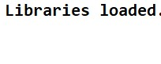 |
| Riders data preview | 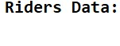 |
| Riders shape | 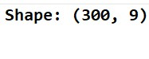 |
| Trips data | 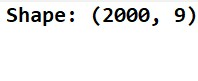 |
| Trips shape | 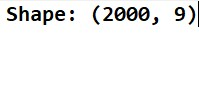 |
| City zones data | 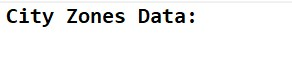 |
| City zones shape | 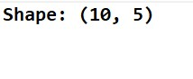 |
| Info and missing values | 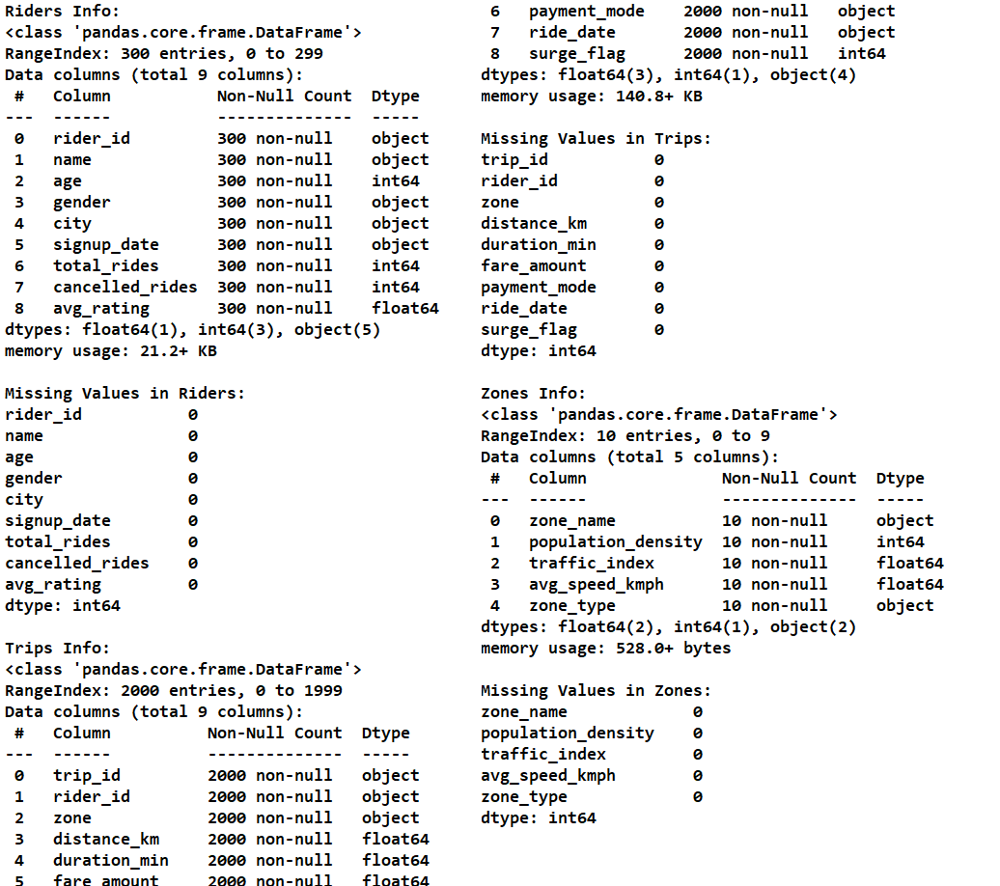 |
| Missing values filled | 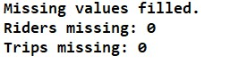 |
| Outliers handled | 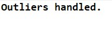 |
| Date features |  |
| Encoding | 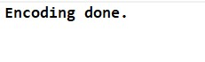 |
| Binning and transformations |  |
| Scaling |  |
| Merged data |  |
| New features |  |
| Final shape and columns | 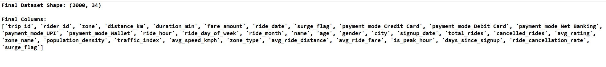 |
| File saved | 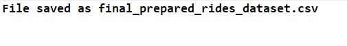 |

---

## Tech Stack

- Python 3
- Pandas, NumPy
- Matplotlib, Seaborn
- Scikit-learn (`SimpleImputer`, `KNNImputer`, `LabelEncoder`, `StandardScaler`, `MinMaxScaler`)
- `json`, `sqlite3`
- Jupyter Notebook

---

## How to Run

```bash
pip install pandas numpy matplotlib seaborn scikit-learn jupyter
jupyter notebook Ride_Demand_Project.ipynb
```

Keep `riders.csv`, `trips.json` and `city_zones.sql` in the same folder as the notebook, then run all cells. The final dataset will be saved as `final_prepared_rides_dataset.csv`.

---

## Author

**Subhash**
BCA (Semester 5), Veer Narmad South Gujarat University (VNSGU)
Aspiring AI/ML practitioner
